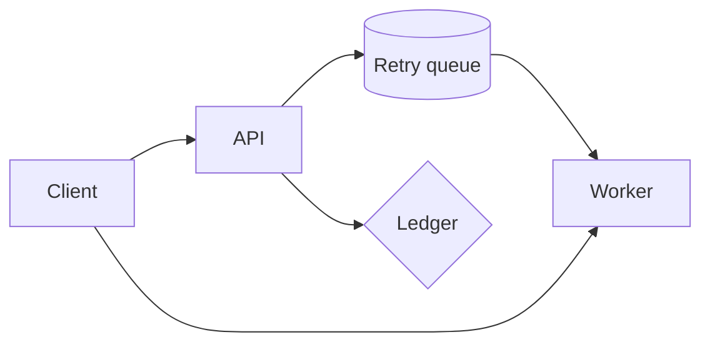

# Retry queue rollout

## Tasks

- [x] Schema migration
- [x] Load test at 2k rps
- [ ] Runbook update
- [ ] Remove `/v1/charge`

## Latency

<!-- mdx: col=p99 warn=150 error=500 -->
| Endpoint     | p50   | p99    |
|:-------------|------:|-------:|
| `/v2/charge` | 41 ms | 180 ms |
| `/v2/refund` | 38 ms | 650 ms |
| `/v2/status` | 12 ms |  44 ms |

## Backoff

```python
for n in range(5):
    print(n, min(2 ** n, 30))
```

## Request path



## Links

See [the guide](docs/guide.md), [its setup](docs/guide.md#setup), [latency](#latency),
the [runbook](docs/runbook.md), [a bad anchor](#nope) and [the site](https://example.com).
